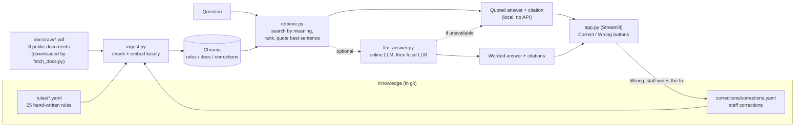
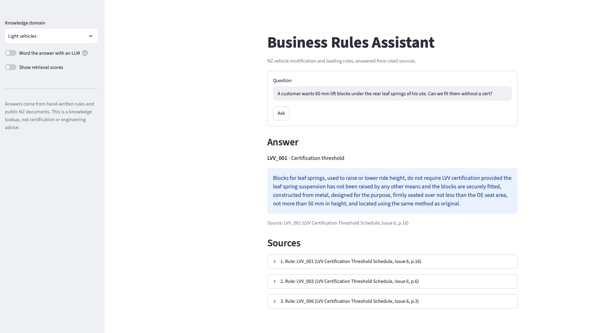
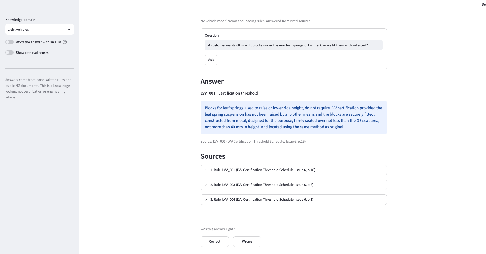
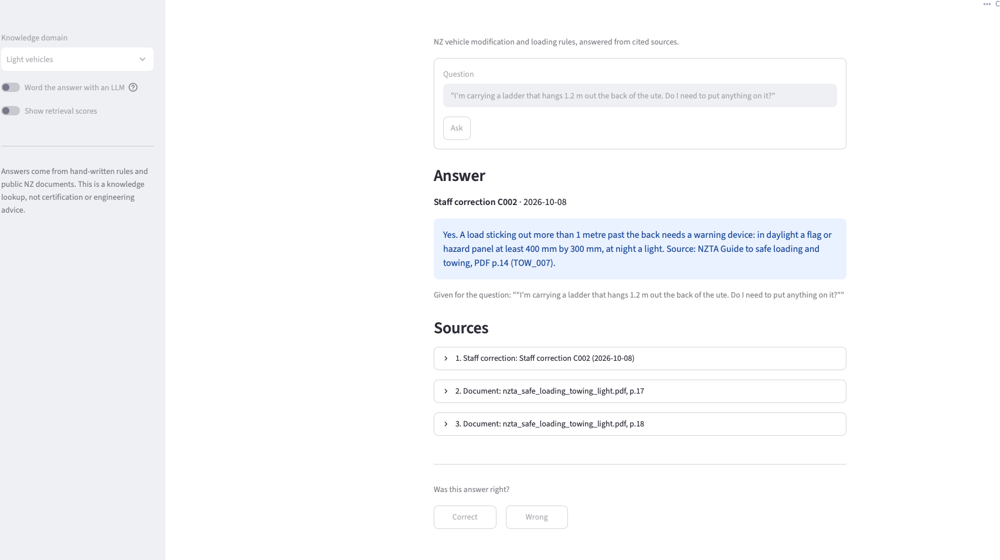
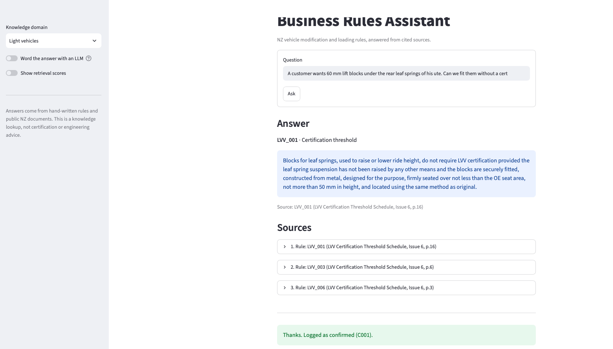

# Business Rules Assistant

A question-answering assistant for New Zealand vehicle modification and loading rules. Every answer cites the rule or document page it came from, and the knowledge lives in version-controlled files, not in a model.

## 1. Problem

Workshop and fit-out staff regularly need answers such as "can we fit 60 mm lift blocks without certification?" or "how strong do the lashings on an 8-tonne crate need to be?". The answers exist, but they are spread across manufacturer compliance sheets, NZTA manuals and LVVTA schedules that run to hundreds of pages. Staff either search the PDFs by hand, ask a colleague, or guess.

This project turns those sources into a small, maintained knowledge base: 25 hand-written rules, each traced to a page, backed by the full source documents. Staff ask in plain words and get the relevant rule or passage with its citation. When an answer is wrong, they correct it in the app, and the correction is used from then on. Nothing is retrained.

## 2. Architecture



Retrieval runs entirely on the local machine. The LLM step is optional and isolated in one file: with it switched off, no data leaves the machine.

## 3. The separation demo: edit a rule, the answer changes

The knowledge is in YAML files, so changing what the assistant says means editing a file, not retraining a model.

1. Ask: *"A customer wants 60 mm lift blocks under the rear leaf springs of his ute. Can we fit them without a cert?"* The answer cites rule `LVV_001`: blocks up to **50 mm** need no LVV certification.
2. In `rules/light_vehicle/modifications.yaml`, change `50 mm` to `40 mm` in `LVV_001`.
3. Run `python src/ingest.py --domain light_vehicle`.
4. Ask again. The answer now says **40 mm**. The old version cannot linger, because ingest deletes and rebuilds the domain on every run.

| Before | After |
|---|---|
|  |  |

The same applies to corrections: a staff member marks an answer wrong and types the right one, it is saved to `corrections/corrections.yaml`, and after the next ingest the corrected answer is returned for that question, labelled as a staff correction. Below, the ladder question (which the search answers wrongly on its own) now returns staff correction C002:



## 4. The interface



The answer shows the rule (with its ID and type) or the best-matching sentence from a document, always with its source. The sources behind it can be expanded to read in full. Two buttons under every answer record whether it was right.

## 5. Design decisions

| Decision | Choice | Why |
|---|---|---|
| Rules vs documents | Indexed separately; rules get a +0.10 ranking boost | A stated business rule should beat a sentence buried in a manual |
| Rule authoring | Candidate sentences mined from the PDFs by pattern (`extract_candidates.py`), reviewed by hand, then written as rules | Extraction is automated; the decision is not. Every rule traces to a page |
| Rule format | YAML with a nested `source` block (document, file, page, section) | Readable and editable by people; precise enough for citations |
| Embeddings | `all-MiniLM-L6-v2`, run locally | No API cost; runs offline once the model is cached |
| Chunk size | 500 characters with 50 overlap (characters, not tokens) | About 100 to 125 tokens, inside the model's 256-token limit, which would silently cut longer chunks |
| What is shown | The chunk before and after each match ("search small, show big"), then the single best sentence quoted as the answer | Small chunks search precisely; quoting keeps the answer short and word-for-word from the source |
| Retrieval | Top 3, filtered by domain | Enough context, few enough to cite clearly |
| Vector store | Chroma, local and persistent | No service to run |
| Citations | Rule ID or document and page, always shown | An uncited answer is not usable in a compliance setting |
| LLM | Optional; any OpenAI-compatible provider via `.env`; temperature 0; falls back to a local model, then to the quoted answer | The core works with no paid service, and a provider outage never breaks the app |
| Corrections | Matched on the question; used only when a new question is nearly identical | One correction should not take over unrelated questions |

## 6. Evaluation

Fifteen questions in `eval/questions.yaml`, written and committed before any retrieval code existed: 10 answered by a rule, 4 answered only by a document page, and 1 with no answer in the data. `python src/run_eval.py` produces `eval/eval_report.md`.

**Retrieval (basic path, no LLM)**

| Measure | Result |
|---|---|
| Expected source ranked first | 11 of 14 answerable questions |
| Rule questions | 9 of 10 |
| Document-page questions | 2 of 4 |
| Refused the unanswerable question | No |

**With the LLM writing the answer** (Gemini, first run of the original prompt)

| Measure | Result |
|---|---|
| Correct, cited answer | 11 of 15 (including correctly refusing the unanswerable question) |
| Said "not found" | 4 |
| Confident wrong answers | 0 |

The LLM's main gain is not the count. On the failures, the basic path presents an unrelated rule as if it were the answer; the LLM says it does not know. It also turns rules into direct answers ("No, 60 mm exceeds the 50 mm limit"; "1,500 kg"; "16 tonnes").

**Failures and why.** Three questions fail in both modes because the passage holding the answer is never retrieved: a bull bar row in a mixed table (Q08), a one-sentence trailer gap rule at the end of a tow ball paragraph (Q09), and a ladder question whose words do not match the overhang rule's wording (Q06). Sentence-level chunking was tried for Q08 and Q09 and made no difference: the passages were cut cleanly but still outranked, so it was reverted. One question (Q12) was answered "not found" by the LLM although the right rule was retrieved, because the original prompt allowed no conditional answers; the prompt was revised to allow them, and that question is still to be re-tested (free-tier quota).

The question set is small (one question is about 7 percentage points) and was used while fixing, so these figures show direction rather than precision.

## 7. How to run

Requires Python 3.10 or newer (built with 3.14).

```bash
python3 -m venv .venv
source .venv/bin/activate
pip install -r requirements.txt

python src/fetch_docs.py      # download the 8 public PDFs into docs/raw/
python src/ingest.py          # build the local search index (first run downloads the ~90 MB embedding model)

python src/retrieve.py "Does a trailer that weighs 2,400 kg loaded need its own brakes?" --domain light_vehicle
streamlit run src/app.py      # the web interface
python src/run_eval.py        # the evaluation report
```

**Optional LLM.** Copy `.env.example` to `.env` and set `LLM_API_KEY`, `LLM_MODEL` and, for providers other than OpenAI, `LLM_BASE_URL`. Then add `--llm` to `retrieve.py` or `run_eval.py`, or use the toggle in the app. `LOCAL_LLM_MODEL` names an optional fallback model served locally (for example with Ollama).

**Project layout**

| Path | Contents |
|---|---|
| `rules/<domain>/*.yaml` | Hand-written rules; one folder per domain (`light_vehicle`, `heavy_vehicle`) |
| `corrections/corrections.yaml` | Staff feedback written by the app |
| `docs/sources.md` | Every source: title, publisher, edition, URL |
| `src/` | `fetch_docs`, `extract_candidates`, `ingest`, `retrieve`, `llm_answer`, `corrections`, `app`, `run_eval` |
| `eval/` | Questions and the generated report |

## 8. Known limitations

- **The basic path cannot refuse.** Similarity measures "same topic", not "answers the question", so without the LLM an unanswerable question still gets the closest rule. The domain selector has the same weakness: a light-vehicle question asked in the heavy domain returns a heavy rule.
- **Tables extract poorly.** The FUSO wheelbase tables and parts of the NZTA tables lose their structure as text, so model-specific wheelbase ranges are not answerable directly.
- **Small evaluation set**, written by the author and used while fixing; no held-out set.
- **Light domain has no manufacturer source.** The Toyota body builder's guide was dropped because it requires a sign-in, so light-vehicle answers are regulatory only.
- **Source currency.** The LVVTA schedule is Issue 6 (May 2020) and the NZTA manual is a dated export; rules record a `last_reviewed` date and need re-checking when sources change.
- **This is a knowledge lookup, not certification or engineering advice.**

## 9. Data statement

- **Documents:** eight public documents from NZ Transport Agency Waka Kotahi, the Low Volume Vehicle Technical Association and Fuso New Zealand, listed with editions and URLs in `docs/sources.md`. They are downloaded by `src/fetch_docs.py` and are not committed to this repository.
- **Rules:** the 25 rules in `rules/` were written for this project from those documents. Candidate sentences were shortlisted by script, reviewed by hand, and written as rules with an AI assistant's help; each was checked against its cited page. They are an interpretation for demonstration, not an official restatement.
- **Corrections:** entries in `corrections/corrections.yaml` were written during testing.
- **No private or company data** is used. With the optional LLM switched on, the question and the retrieved public text are sent to the configured provider.

## 10. Status and roadmap

This is a working first version. The light and heavy vehicle domains, the local retrieval path, staff corrections and the evaluation are complete.

| Next | Why |
|---|---|
| Re-run the full LLM evaluation | The revised prompt has only been partly tested because of free-tier API limits (Q06, Q09 and Q12 are pending) |
| Local LLM fallback (Ollama) | So the app can write answers with no API key or quota |
| Short demo video | A walkthrough of the rule-edit demo |
| Bring-your-own-documents mode (v2) | Let any team use the same app: create a workspace, upload their own PDFs (and optional rules), and build the index with one button, with no command line |
| Choose your own LLM (v2) | A settings panel to pick OpenAI, Anthropic, Gemini or a local Ollama model, paste an API key (kept in the session only, never saved) and test the connection. Providers sit behind one small preset table, so adding one is a single entry. "No LLM" stays the default |
| A new domain: housing | Same pipeline, new documents and rules; it will be added once it is fully built and evaluated, to test how little code a new domain needs |
